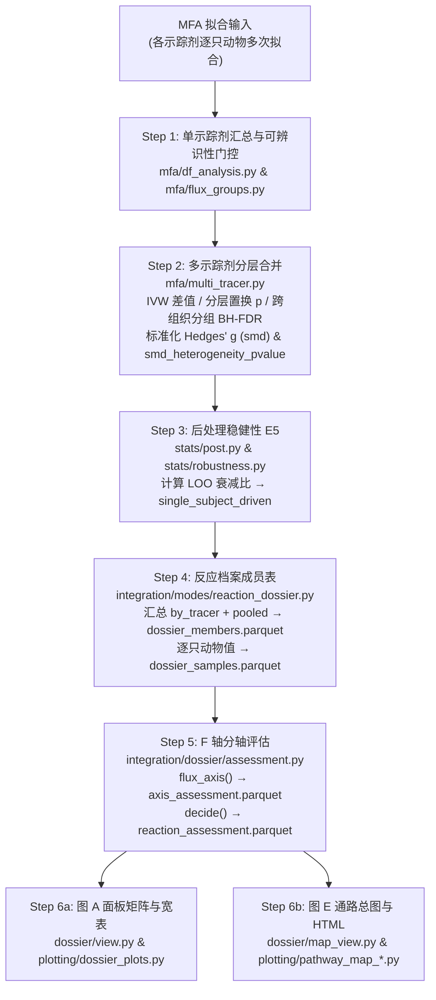

# 多组学整合与代谢通路绘制中 MFA 通量（ASSESSMENT Flux）评估流程、阈值设定及改进方案

> **文档类型**：统计方法与阈值基线说明书（v1.4，2026-11-23）  
> **覆盖模块**：`mfa`（单/多示踪剂差异通量与合并）、`stats/robustness`（E5 稳健性）、`integration/modes/reaction_dossier`（成员档案）、`integration/dossier/assessment`（分轴评估）、`integration/plotting` & `visualization/primitives`（图 A 面板矩阵与图 E 通路总图）  
> **核查依据**：当前仓库源码及 `local/projects/dio_project` 最新整合运行包 `run_20261121_182112_fa44` 实测数据  
> **配套文档**：[反应档案与分轴综合评估](../arch_design/omicsweave_reaction_dossier_and_assessment.md) · [分组织代谢通路总图（图 E）](../arch_design/omicsweave_pathway_map.md)

---

## 1. 核心结论摘要

1. **图上显示为 `Unchanged`（`—`）的 Flux 格，后台实际几乎都是 `undetermined`**：
   - F 轴评估函数 `flux_axis()` **从不输出 `unchanged`**，其“有可辨识示踪剂但未达 `Sig.` / `Suggestive`”的统一状态为 **`undetermined`**。
   - 由于当前绘图原语将 `unchanged`、`equivalent`、`no_evidence`、`undetermined` 共用短横线 `—`，且图例仅将该符号标注为 `Unchanged`，导致读者把“证据不足 / 效应小 / 不稳定（`undetermined`）”误读为“通量无变化（`unchanged`）”。
2. **F 轴 `Suggestive` 的真实判据不是名义 `p < 0.05`，而是 `|Hedges' g| ≥ 1.0` 且方向严格稳定**：
   - 图 A 左侧 `FLUX by tracer` 展示的是 `log2FC`，但评估块看的是**标准化合并效应量 `|Hedges' g|`** 和**留一法方向稳定性**。因此，即使多示踪剂及 `pooled` 的 `log2FC` 全部同号（甚至 `pooled` 已达名义 `p < 0.05`），仍可能因以下四类原因落入 `undetermined`：
     1. 组内方差大或小样本校正压缩，导致合并 `|Hedges' g| < 1.0`；
     2. 多示踪剂下缺少自带的 `direction_stability`，回退为**所有可辨识示踪剂逐一 LOO 取最小值 `min(computed) >= 1.0`**，任意一个弱信息/低样本示踪剂反号即“一票否决”；
     3. 触发 `single_subject_driven`（且当前 `stats/robustness.py` 对多示踪剂 MFA **未按示踪剂分层、未剔除不可辨识示踪剂**，存在误伤隐患）；
     4. `Sig.`（`L3`）在当前每组 $n = 2\text{--}4$ 且跨全部组织联合做分组 BH-FDR 的口径下，`padj` 普遍接近 `0.998`，极难 `< 0.05`。
3. **改进策略分两条线并行**：
   - **展示与绘图层（先消除误读）**：拆分 `Unchanged` 与 `Undetermined` 图标/图例、修正图例统计口径说明、在矩阵导出表与 HTML 抽屉中显式暴露 `Hedges' g`、LOO 稳定性及未达标具体原因（V1–V5）；
   - **统计与阈值层（先修工程缺陷，再审慎演进方法）**：优先修复 `robustness.py` 多示踪剂混算问题（S1），重构多示踪剂合并方向稳定性计算（S2），评估 BH-FDR 校正域（单组织 vs 跨组织）与小样本 `Suggestive` 判据的统计功效与假阳性权衡（S3–S6）。

---

## 2. 端到端分析流程与代码链路

从原始 MFA 拟合结果到面板矩阵图（图 A）与分组织代谢通路总图（图 E）中的 `ASSESSMENT -> Flux` 格，完整数据流如下：

### 各阶段关键统计与代码定位

| 阶段 | 代码文件与核心函数 | 关键计算与产物 |
|---|---|---|
| **Step 1 单示踪剂通量与通量组** | `src/omicsweave/mfa/df_analysis.py` (`sample_flux_matrix`, `_standardized_mean_difference`, `differential_flux`) `src/omicsweave/mfa/flux_groups.py` (`locked_groups`, `grouped_bh`) | 1. 每只动物内对同次拟合求 `forward - reverse` 净通量，IQR 过滤后取中位数作为动物代表值； 2. 标注可辨识性：`well_constrained` / `moderate` / `undetermined` / `poorly_constrained` / `bound_pinned`； 3. 计算 Cohen's $d$ 与小样本校正 Hedges' $g = \left(1 - \frac{3}{4df - 1}\right)d$（$df = n_a + n_b - 2$）； 4. 识别跨所有拟合 $|r| \ge 1 - 10^{-6}$ 的化学计量锁死通量组（`flux_group`）。 |
| **Step 2 多示踪剂分层合并** | `src/omicsweave/mfa/multi_tracer.py` (`pool_contrast`, `_pool_reaction`, `_pool_standardized`, `to_differential`) `src/omicsweave/mfa/runner.py` (`_run_multi_tracer`) | 1. 门控剔除 `low_n`（任一组 $< 2$）、`poorly_constrained` / `bound_pinned` 与零方差示踪剂； 2. 绝对尺度方差 $V_t = (s_A^2 + \bar{f}_A)/n_A + (s_B^2 + \bar{f}_B)/n_B$，逆方差合并均值差，并在各示踪剂内独立置换组标签得 `permutation_pvalue`； 3. 标准化尺度按 $1/\mathrm{Var}(g_t)$ 合并各示踪剂的 Hedges' $g$ 得 `effect_size`（即 `smd`）及 Cochran's $Q$ 检验 `smd_heterogeneity_pvalue`； 4. 调用 `grouped_bh` 对**当前比较下的全部组织**统一做分组 BH-FDR 得 `padj`； 5. **注**：`to_differential()` 不生成 `direction_stability` 列。 |
| **Step 3 后处理稳健性（E5）** | `src/omicsweave/stats/post.py` (`postprocess`) `src/omicsweave/stats/robustness.py` (`robustness`, `leave_one_out`, `flag_rows`) | 对 `differential.parquet` 中 `selected == True` 的特征读取 `omics/mfa/data/<tissue>/` 矩阵，逐只去除样本重算组均值差；若任意一次去样本后反号或比值 `< 0.5`（`DEFAULT_MIN_RATIO`），写入 `single_subject_driven` 标记。 |
| **Step 4 反应档案成员组装** | `src/omicsweave/integration/modes/reaction_dossier.py` (`_mfa_rows`, `_mfa_stats`, `_mfa_state`, `_state`) | 1. 读入 `differential_by_tracer.parquet` 与 `differential.parquet`（记为 `tracer="pooled"`）； 2. 净通量跨零变号时按组均值差重新定号并标 `net_flux_sign_change`； 3. `heterogeneity_pvalue` 优先取 `smd_heterogeneity_pvalue`，缺失时回退绝对尺度 `heterogeneity_pvalue`； 4. 单格状态 `_mfa_state`：先判 `insufficient_n`（较小组 $< 2$）与 `not_identifiable`（`poorly_constrained` / `bound_pinned`），否则按 `padj < 0.05` → `changed`、`pvalue < 0.05` → `nominal`、TOST 90% CI 落在 `±0.58` 内 → `equivalent`、其余 → `no_evidence`。 |
| **Step 5 F 轴综合评估** | `src/omicsweave/integration/dossier/assessment.py` (`flux_axis`, `_flux_stability`, `loo_stability`, `decide`) | 独立读取每个 `(flux_id, tissue, contrast_id)` 的本实验 MFA 成员行与逐只动物表 `dossier_samples.parquet`，执行分轴判定（见第 3 节），再由 `decide()` 汇总生成结论等级 `L3` / `L2` / `L1` / `L0` / `LX`。 |
| **Step 6 可视化与表导出** | `src/omicsweave/integration/dossier/view.py` `src/omicsweave/integration/dossier/map_view.py` `src/omicsweave/visualization/primitives.py` (`draw_status_cell`) `src/omicsweave/integration/plotting/dossier_plots.py` `src/omicsweave/integration/plotting/pathway_map_plots.py` `src/omicsweave/integration/plotting/pathway_map_html.py` | 将 `axis_assessment` 的 `state` 和 `direction` 映射为矢量状态图标：实心三角（`changed`）、空心三角（`suggestive`）、红蓝斜拼格（`mixed`）、灰色短横线 `—`（`unchanged` / `equivalent` / `no_evidence` / **`undetermined`**）。 |

---

## 3. 当前统计判定条件与默认阈值设定

### 3.1 `RULES` 默认阈值基线

定义于 `src/omicsweave/integration/dossier/assessment.py`（L33–L40），可在 `experiment.yaml` 的 `integration.parameters.reaction_dossier.rules` 中覆盖：

| 参数名 | 默认值 | 适用轴 / 阶段 | 作用说明 |
|---|--:|---|---|
| `alpha` | `0.05` | 四轴与单格 | FDR / 显著性阈值；F 轴 `changed` 要求 `head["padj"] < alpha` |
| `flux_min_abs_g` | `1.0` | F 轴 | 1. 判 `mixed` 时要求相反方向示踪剂各自 `|g| >= 1.0`； 2. 判 `suggestive` 时要求合并效应量 `|Hedges' g| >= 1.0` |
| `heterogeneity_alpha` | `0.10` | F 轴 | 标准化异质性 Cochran's $Q$ 检验阈值；`< 0.10` 标记 `tracer_heterogeneity`，阻止进入 `changed`（但不单独判 `mixed`） |
| `direction_stability_min` | `0.8` | F 轴 | 仅用于差异结果自带自助法 `direction_stability` 列时；无该列时改用逐只动物 LOO，硬门槛为 `min(computed) >= 1.0` |
| `established_min_group` | `3` | F 轴 | `changed`（`L3`）要求的较小组最小样本量 `min(n_num, n_den) >= 3` |
| `equivalence_bound` | `0.58` | C / R / M 轴与单格 | TOST 90% 置信区间等效界（$\log_2(1.5) \approx 0.585$）；F 轴汇总当前未使用等效状态 |
| `minor_share` | `0.2` | C 轴 | 同工酶主要成员丰度占比下限（来自 `isozyme.minor_share`） |
| `opposition_min_state` | `"suggestive"` | `decide()` | L1 判定中 R/M 轴否决 C 轴的最低状态 |
| `rna_single_source_changed` | `False` | C 轴 | 无蛋白组时是否允许单一队列 RNA 通过 FDR 即判为 `changed` |

### 3.2 F 轴（Flux）完整状态判定树

按代码执行顺序（`flux_axis()`, `assessment.py` L169–L246），命中即返回（最后统一执行 `expected_tracers` 复核）：

| 顺序 | 内部状态 `state` | 结论等级 | 图上符号与图例标签 | 触发条件（全部满足） |
|:--:|---|---|---|---|
| 1 | `not_measured` | `L0` | `/`（Not measured） | 无非 `not_infused` / `not_measured` 的示踪剂，且无有效 `pooled` |
| 2 | `insufficient_n` | `L0` | `⚠`（QC / Low-n） | 存在测量但无可用示踪剂，且全部测量示踪剂（或仅有的 `pooled`）均为 `insufficient_n`（较小组 $< 2$） |
| 3 | `not_identifiable` | `L0` | `⊘`（Unident. flux） | 存在测量但剔除 `not_identifiable` / `insufficient_n` 后为空（且非全部 `insufficient_n`） |
| 4 | `mixed` (`conflicting`) | `LX` | 红蓝斜拼（Mixed） | 至少 `2` 种可辨识且各自 `|effect| >= flux_min_abs_g`（`1.0`）的示踪剂 `log2fc` 异号 |
| 5 | **`changed` (`established`)** | **`L3`** | **实心红/蓝三角（`Sig. (FDR<0.05)`）** | 同时满足 6 条： ① 可辨识示踪剂数 `>= 2`； ② 所有可辨识示踪剂 `log2fc` 严格同号（`len(signs) == 1`）； ③ 无显著异质性（`heterogeneity_pvalue >= 0.10` 或 NaN）； ④ 合并估计通过 FDR（`padj < 0.05`）； ⑤ 较小组样本量 `n_min >= 3`； ⑥ 方向稳定（`stable == True` 且无 `single_subject_driven`）。 |
| 6 | **`suggestive`** | **`L2`** | **空心红/蓝三角（`Suggestive (p<0.05)`）** | 不满足第 5 条，但同时满足： ① 合并效应量 `|head["effect"]| >= 1.0`（`|Hedges' g|`）； ② 方向稳定（`stable == True`：自带 `direction_stability >= 0.8`，或无该列时所有可辨识示踪剂的逐只动物 LOO `min(computed) >= 1.0`，且无 `single_subject_driven`）。 |
| 7 | **`undetermined`** | **`L0`（或由 C 轴升为 `L1`）** | **淡灰短横线 `—`（图例仅标 `Unchanged`）** | 以上均未满足（可辨识，但 `|g| < 1.0`、LOO 不稳定、`stability_unknown` 或存在 `single_subject_driven`）。 |
| 复核 | 强制降级为 `undetermined` | 降回 `L0` / `L1` | 同上（附加 `tracer_expectation_mismatch`） | 若 `panels.yaml` 声明了 `expected_tracers`，且实际可辨识示踪剂集合与声明不符（存在预期外可辨识示踪剂，或预期示踪剂在样本量足够下不可辨识），原本的 `changed` / `suggestive` 强制降为 `undetermined`。 |

### 3.3 F 轴与 C / R / M 轴状态体系的关键差异

| 维度 | F 轴（Flux） | C 轴（酶容量）/ R 轴（调控）/ M 轴（底物与产物） |
|---|---|---|
| `unchanged` 状态是否存在 | **不存在**（未实现通量级等效性检验） | **存在**（主要成员 / 全部成员通过 TOST 等效性检验，90% CI 落在 `±0.58` 内） |
| `suggestive` 核心判据 | 合并 `|Hedges' g| >= 1.0` + 方向稳定（**不看名义 `p < 0.05`**） | 主要成员/带符号成员达到名义 `p < 0.05`（或仅单队列 RNA、调控因子丰度变化、单只动物驱动的 `changed` 降级） |
| `changed` 核心判据 | `≥ 2` 示踪剂同向 + 无异质性 + `padj < 0.05` + `n_min ≥ 3` + 稳定 | 通过 `padj < 0.05` 且满足主要同工酶/复合体核心亚基/效应物实测等生物学规则 |

---

## 4. 现象深度诊断：为何多示踪剂及 `pooled` 流量全正/全负仍显示 `Unchanged`？

核查 `dio_project/run_20261121_182112_fa44` 全部组织与比较的通路总图数据，F 轴状态分布为：
- `not_measured`: **2,167**
- `undetermined`: **769**
- `not_identifiable`: **395**
- `suggestive`（`L2`）: **31**
- `mixed`（`LX`）: **19**
- `changed`（`L3` / `Sig.`）: **0**
- `unchanged`: **0**

结合代码与实测样本，出现“多示踪剂及 `pooled` 全同号，但 ASSESSMENT Flux 仍画为 `—`（图例标 `Unchanged`）”的完整根因如下：

### 4.1 典型实测反应对照表（`dio_project` · `run_20261121_182112_fa44` · `HFD_vs_LFD`）

| 组织 / 反应 | 各可辨识示踪剂 `log2FC` | `pooled log2FC` | `pooled p` / `padj` | 合并 `\|Hedges' g\|` | F 轴输出状态 | 实际卡点诊断 |
|---|---|---|---|--:|---|---|
| 心脏 `PGM_c` / `ENO_c`（对照：通过） | Glc `+4.78`, Gly `+2.54` | `+1.49` (`nominal`) | `0.0129` / `0.9985` | **1.31** | **`suggestive` (`L2`)** | 满足 `\|g\| ≥ 1.0` 且全部可辨识示踪剂 LOO = 1.0、无 `single_subject_driven`；因 `padj=0.9985` 未达 `L3` |
| 心脏 `PYK_c` | Glc `+0.98`, Gly `+1.28`, Lac `+2.65`, Ala `+3.47` | `+1.50` (`no_evidence`) | `0.0840` / `0.9985` | **0.66** | `undetermined`（图上 `—`） | 4 种示踪剂全正但动物间离散度大，合并 `\|g\| = 0.66 < 1.0` |
| 肝脏 `PYR_trans` | Glc `-0.99`, Gly `-1.51`, Lac `-1.11`, Ala `-1.25` | `-1.14` (`no_evidence`) | `0.1280` / `0.9985` | **0.78** | `undetermined`（图上 `—`） | 4 种示踪剂全负，但合并 `\|g\| = 0.78 < 1.0` |
| 肝脏 `PC_m` | Gly `-1.45`, Ala `-5.32` | `-3.58` (`no_evidence`) | `0.1850` / `0.9985` | **0.81** | `undetermined`（图上 `—`） | 2 种可辨识示踪剂全负，但合并 `\|g\| = 0.81 < 1.0` |
| 心脏 `AKGD_m` | Gly `+0.54`, Lac `+3.28`, Ala `+1.25` | `+1.51` (`no_evidence`) | `0.2825` / `0.9985` | **0.54** | `undetermined`（图上 `—`） | 3 种可辨识示踪剂全正，但合并 `\|g\| = 0.54 < 1.0` |
| 皮下脂肪 `BHB_input` ~ `ACACCOA_lyase_m` | Lac `-1.90`, Ala `-1.85` | `-1.87` (**`nominal`**) | **`0.0333`** / `0.9985` | **0.81** | `undetermined`（图上 `—`） | `pooled` 已过名义 `p < 0.05`，但 F 轴 `Suggestive` 只看 `\|g\| ≥ 1.0`（且 `n=2v2` + `3v3` 的 Hedges 小样本校正压缩了 $g$ 值） |
| 心脏 `G3PP_c` | Glc `-0.84`, Lac `-1.28`, Ala `-0.13` | `-0.75` (**`nominal`**) | **`0.0224`** / `0.9985` | **1.10** | `undetermined`（图上 `—`） | 已满足 `\|g\| ≥ 1.0` 且 `p < 0.05`，但卡在 **LOO 一票否决**：`alanine` 仅 `-0.13`（或 `lactate` 仅 2v2）去一只动物反号，致 `min(computed) < 1.0` |
| 心脏 `PDH_m` | Gly `-1.03`（仅 1 种可辨识） | `-1.03` (`no_evidence`) | `0.1000` / `NaN` | **1.14** | `undetermined`（图上 `—`） | 已满足 `\|g\| ≥ 1.0`，但 `pooled` 带有 **`single_subject_driven`**（且由跨示踪剂未分层混算产生） |
| 心脏 `GLN_exchange` | Lac `+4.68`（仅 1 种可辨识） | `+4.68` (`no_evidence`) | `0.3333` / `NaN` | **49.13** | `undetermined`（图上 `—`） | 同上，卡在 `pooled` 的 **`single_subject_driven`** |

### 4.2 五大根本原因汇总

1. **视觉与图例混同（认知落差来源）**：
   - `undetermined` 与 `unchanged` 共用 `—`，图例只写 `Unchanged`；
   - 图例把 `Suggestive` 写为 `Suggestive (p<0.05)`，当用户看到 `pooled` 格子本身是 `nominal (p<0.05)`（如 `BHB_input`、`G3PP_c`）而评估列却显示 `—` 时，会直接产生困惑。
2. **显示指标与判定指标不一致 + 小样本 Hedges' $g$ 压缩效应**：
   - 矩阵格子展示的是 `log2FC`，但评估门控使用的是标准化效应量 `|Hedges' g| >= 1.0`；
   - 在 `df_analysis.py` L358 中，Hedges' $g$ 校正系数为 $J(df) = 1 - \frac{3}{4df - 1}$：当某示踪剂为 $2\text{ vs }2$（$df=2$）时，$J = 4/7 \approx 0.571$（将 Cohen's $d$ 压缩 43%）；当为 $3\text{ vs }3$（$df=4$）时，$J = 0.80$（压缩 20%）。因此小样本示踪剂即便真实分组清晰，合并 Hedges' $g$ 也容易落在 `0.75–0.95` 之间。
3. **多示踪剂 LOO 稳定性的“最弱一票否决”机制**：
   - `multi_tracer.to_differential` 未计算并输出 `direction_stability`，导致 `flux_axis()` 必须退回到对所有可辨识示踪剂分别计算 `loo_stability`，再取 **`min(computed) >= 1.0`**（`assessment.py` L214–L218）。
   - 这会引发一个反直觉的统计现象：**多增加一个信息量较弱或样本量较小（如 `n=2 vs 2`）的可辨识示踪剂，反而更容易因为该示踪剂单次反号而否决主示踪剂和合并估计原本稳定的信号**（如 `G3PP_c`）。
4. **`single_subject_driven` 在多示踪剂 MFA 中未分层、未剔除不可辨识示踪剂（工程缺陷）**：
   - `stats/robustness.py`（L55–L90）直接读取 `omics/mfa/data/<tissue>/` 整个矩阵按组别计算未分层的算术均值差 LOO，没有按 `protocol`（示踪剂）分层，也没有排除 `poorly_constrained` / `bound_pinned` 示踪剂的样本。
   - 不可辨识示踪剂的极端拟合值会直接主导未分层均值，从而误给仅由某个有效示踪剂约束的反应（如 `PDH_m`、`GLN_exchange`）打上 `single_subject_driven` 标记并导致 `flux_axis()` 强制降级。
5. **多示踪剂 `grouped_bh` 跨全部组织合并校正导致 `padj` 严重保守**：
   - `mfa/runner.py`（L272–L278）将每个比较下**所有组织（7 个组织）**的 `pooled` 结果合并在同一张表里送入 `multi_tracer.to_differential()` 执行一次 `grouped_bh`。
   - 相比之下，转录组、蛋白组、代谢组均遵循 `design.stratify_by: [tissue]` 按**（组织 × 比较）**分别做 BH-FDR，`assessment.py` 的合取检验（L635）也是按**（组织 × 比较）**做 BH-FDR。跨 7 个组织联合校正使独立检验数 $m$ 扩大约 6–7 倍，导致原本 $p = 0.01\text{--}0.03$ 的结果全部被压至 `padj ≈ 0.9985`，令 `L3 / Sig.` 在当前样本量下几乎不可能达成。

---

## 5. 潜在改进措施（一）：展示与绘图功能改进方案

以下改进**不降低统计严谨性**，核心目标是消除视觉歧义、提升结果可解释性与溯源效率：

| 编号 | 优先级 | 改进措施 | 涉及代码位置 | 预期收益 |
|:--:|:--:|---|---|---|
| **V1** | **P0** | **区分 `Unchanged` 与 `Undetermined` 的图形符号与图例** • `unchanged` / `equivalent`（通过 TOST 等效检验）保持实线短横 `—` 或双短横 `=`，图例标注 `Unchanged (equiv.)`； • `undetermined` / `no_evidence`（测到/可辨识但证据不足）改为虚线短横 `╌` 或淡灰空心小圆/问号点，图例单列 `Undetermined (insufficient / unstable)`。 | `visualization/primitives.py` (`draw_status_cell`) `integration/plotting/dossier_plots.py` (`_matrix_legend`) `integration/plotting/pathway_map_plots.py` `integration/plotting/pathway_map_html.py` | 彻底消除“全正/全负却标为 Unchanged”的直接误解；忠实体现设计文档 3.2 第 3 条原则（“无变化不能由不显著推出”）。 |
| **V2** | **P0** | **修正图 A 与图 E 图例的统计口径说明** • 将笼统的 `Sig. (FDR<0.05)` / `Suggestive (p<0.05)` 细化或附注：   - `Sig.`：Omics `FDR<0.05`；Flux `≥2 tracers & FDR<0.05`；   - `Suggestive`：Omics `p<0.05`；Flux `\|g\|≥1 & stable`。 | `integration/plotting/dossier_plots.py` (`_matrix_legend`) `integration/plotting/pathway_map_plots.py` | 读者不会再困惑为何 `pooled` 已达 `p < 0.05`（`nominal`）但评估列未亮 `Suggestive`。 |
| **V3** | **P1** | **补全图 A 导出表（TSV / XLSX）的关键判定字段** • 在 `wide_table()` 的 `assessment` 块中补充 `rule`（判定原因）与 `flags` 列； • 在 `MEMBER_EXPORT` 中补充 `effect`（`Hedges' g`）、`heterogeneity_pvalue`、`direction_stability`、`tracer_evidence` 列。 | `integration/dossier/view.py` (`MEMBER_EXPORT`, `wide_table`) | 打开 `matrix_*.tsv` / `.xlsx` 即可直接看到 `|g|` 数值和卡点原因，无需再手动去查 `axis_assessment.parquet`。 |
| **V4** | **P1** | **图 A `FLUX` / `ASSESSMENT` 区块增加轻量门控原因注记** • 当 F 轴为 `undetermined` 但所有可辨识示踪剂同向时，可在表格或可选探索模式（非出版简图）中以极小脚标提示卡点类别（如 `g<1` / `LOO` / `1-subj` / `mismatch`），或在 `pooled` 格下方双行显示 `log2FC` 与 `g`。 | `integration/plotting/dossier_plots.py` `integration/dossier/view.py` | 一眼区分“真微弱效应”与“方向一致但方差大 / 仅被 LOO 或单只动物卡住”，辅助决定补样优先级。 |
| **V5** | **P1** | **交互式 HTML 通路总图（图 E）侧栏增加 F 轴门控检查清单（Gate Checklist）** • 点击任意反应后，在抽屉的 `Flux (MFA)` 卡片下方列出 6 项门控通过状态（可辨识示踪剂数、方向一致性、合并 `|g|`、`p/padj`、异质性 `p`、稳定性/单鼠驱动标记），并展示每条示踪剂的 `loo_stability`。 | `integration/dossier/map_view.py` `integration/plotting/pathway_map_html.py` | 保持静态出版图克制简洁的同时，为科研人员提供完整透明的交互式排障体验。 |

---

## 6. 潜在改进措施（二）：统计方法选用与阈值设定改进方案

按“**必须修复的工程缺陷 → 建议升级的统计方法 → 可配置的阈值与实验设计建议**”分层次整理：

### 6.1 S1（P0 · 工程缺陷修复）：修复多示踪剂 MFA 的 `single_subject_driven` 计算

- **现状问题**：`src/omicsweave/stats/robustness.py` 在 `omics == "mfa"` 时直接对全样本矩阵做未分层 `leave_one_out`，把不同示踪剂（包括 `poorly_constrained` 和 `bound_pinned`）混为一谈。
- **改进方案**：
  1. 针对多示踪剂 MFA（存在 `tracer_coverage.parquet` 与 `samples.tsv` 的 `protocol`），先按 `tracer_coverage` 过滤，仅保留 `informative == True` 且该示踪剂内两组均 $\ge 2$ 的样本；
  2. 在 `informative` 示踪剂内执行**分层留一法（Stratified LOO）**：依次剔除某一个示踪剂中的 1 只动物，重算该示踪剂的均值差/方差（或 Hedges' $g$）以及跨示踪剂合并统计量（推荐采用与 `effect_size` 一致的标准化合并 `smd` 或分层 `z`，避免受绝对通量尺度差干扰）；
  3. 当移除任意 1 只动物导致**合并效应**反号或衰减至原值 `min_ratio`（默认 `0.5`）以下时，才标记 `single_subject_driven`。
- **预期效果**：消除不可辨识示踪剂对有效反应（如 `PDH_m`、`GLN_exchange`）的错误拦截。

### 6.2 S2（P1 · 统计方法升级）：在 `multi_tracer.py` 中直接计算合并方向稳定性，替代 `min(computed) >= 1.0`

- **现状问题**：`multi_tracer.to_differential()` 未输出 `direction_stability`，迫使 `flux_axis()` 对每个可辨识示踪剂分别算 LOO 并取 `min(computed) >= 1.0`（最弱示踪剂一票否决），导致“多一种弱信息示踪剂反而扼杀有效信号”。
- **可选方案对比**：

| 方案 | 计算方法 | 优点 | 缺点 / 注意事项 | 推荐度 |
|---|---|---|---|:-:|
| **方案 A：分层合并 LOO + 分层 Bootstrap 方向稳定性** | 在 `multi_tracer._pool_reaction()` 中： 1. 计算**分层留一法合并效应**（每次去掉 1 只动物重算合并 `smd`），要求 0 次合并方向反转； 2. 同时在各示踪剂各组内独立重抽样（Stratified Bootstrap，如 $B=2000$），计算合并 `smd` 与全样本同号的比例作为 `direction_stability` 写入 `differential.parquet`。 | 与合并效应本身严格对齐；自然按精度加权，不会被低权重/小样本示踪剂一票否决；直接复用 `assessment.py` 已有的 `direction_stability >= 0.8` 分支。 | 需注意某示踪剂 `n=2` 时组内 Bootstrap 抽样空间小（仅 3 种组合），建议与“分层合并 LOO 零反号”联合使用。 | **强烈推荐** |
| **方案 B：按主要权重示踪剂过滤 LOO** | 保留 `assessment.py` 的逐示踪剂 `loo_stability`，但仅对满足 `tracer_weight >= 0.2` 或 `|g_t| >= 0.5` 的示踪剂要求 `loo == 1.0`，弱贡献示踪剂不参与一票否决。 | 改动极小，无需重跑单组学 MFA。 | 仍是逐示踪剂硬切分，不如合并估计的整体稳健性自然。 | 备选过渡方案 |

### 6.3 S3（P1 · 多重检验校准域审视）：评估 MFA 的 `grouped_bh` 校正域（按组织分层 vs 跨全部组织）

- **现状问题**：目前 `mfa/runner.py` L276 对单个比较下的**全部 7 个组织**合并做一次 `grouped_bh`，而 `experiment.yaml` 已明确声明 `design.stratify_by: [tissue]`，且 RNA / 蛋白 / 代谢组和 `assessment.py` 合取检验均按**（组织 × 比较）**各自校正。
- **统计方法讨论**：
  - **按 `(tissue, contrast_id)` 分别做 `grouped_bh`** 的理由：
    1. 与同项目内其他三层组学及 `design.stratify_by: [tissue]` 保持统计契约一致；
    2. 代谢通路总图（图 E）与各组织面板（图 A）本身是按单组织分别解读和交付的（例如心脏面板仅推断心脏的 FDR）；
    3. 每个组织独立的 `flux_group` 数量约 30–50 个（而非 7 个组织合起来的 ~250–350 个），在多示踪剂分层置换下更有可能发挥 `L3 / Sig.` 档位的实际区分力。
  - **跨全部组织合并校正**的适用场景：当研究问题明确是“在全身体 7 个组织 × 所有反应中无预设地筛查 Top 发现”时，跨组织联合 FDR 控制全局错误发现率更保守。
- **建议策略**：在 `omics.mfa.analysis.multi_tracer`（及 `differential_flux`）中提供可配置的 `fdr_scope: per_tissue | per_contrast`（推荐默认与 `design.stratify_by` 对齐即 `per_tissue`，同时在结果表中保留 `padj_global` 供全组织无预设扫描参考）。

### 6.4 S4（P1 · 小样本 `Suggestive` 判据与效应量口径优化）

- **现状分析**：
  - 当多示踪剂合并已经达到分层置换名义显著（`pvalue < 0.05`）、所有可辨识示踪剂方向一致、且合并方向稳定，但合并 `|Hedges' g|` 处于 `0.75–0.99`（如皮下脂肪酮体通路 `p=0.033, log2FC=-1.87, |g|=0.81`），仅仅因为小样本 $J(df)$ 压缩没过 `1.0` 就被归入 `undetermined`，而单示踪剂中一个 `p=0.10, |g|=1.05` 的反应却能成为 `suggestive`，两者在证据强度排序上存在一定倒挂。
- **可行统计方案对比**：

| 方案 | 规则描述 | 适用场景与风险控制 |
|---|---|---|
| **方案 1（保持现行严格标准，仅调参数）** | 维持 `flux_axis()` 结构不变，在特定小样本项目的 `experiment.yaml` 中将 `flux_min_abs_g` 从 `1.0` 调为 `0.8`（对应统计学经典“大效应量”基准 $d \ge 0.8$）做敏感性对照。 | 零代码侵入；必须配套检查 `controls`（阴性对照假阳性）和逐只动物散点图。 |
| **方案 2（引入“多示踪剂一致性 + 置换名义显著”路径）** | 扩展 `Suggestive (L2)` 判定为二选一： • 路径 A（原规则）：`\|Hedges' g\| >= 1.0` 且 `stable`； • 路径 B（多示踪剂一致置换路径）：可辨识示踪剂 `>= 2`、全同向（`len(signs) == 1`）、无显著异质性、分层置换 `pvalue < 0.05`、`|Hedges' g| >= 0.8`（或可配置下限）且 `stable`。 | 解决“多示踪剂一致 + 置换 `p < 0.05` + 近 4 倍变化却不如单示踪剂 `p = 0.10`”的倒挂；同时保持 `>= 2` 示踪剂同向 + `|g| >= 0.8` + `stable` 三重护栏防止微弱效应混入。 |
| **方案 3（小样本 $g$ 的近似精确方差合并或置换标准化统计量）** | 保持 Hedges' $g$ 报告，但评估 `n=2 vs 2` 示踪剂在 `_pool_standardized()` 中因 $J(2)=0.571$ 与 $\mathrm{Var}(g)$ 近似公式带来的偏倚；考虑对 `n_min == 2` 的示踪剂单独标注低自由度，或采用基于精确非中心 $t$ / 合并自由度计算整体标准化效应量。 | 偏向方法学精细化，需通过模拟数据验证 Type I Error 与覆盖率后再决定是否替换。 |

### 6.5 S5（P2 · 为 F 轴补充通量级等效性检验，真正区分 `unchanged` 与 `undetermined`）

- **现状问题**：当前设计中 C / R / M 轴均支持通过 TOST 等效检验输出 `unchanged`（“有充分把握证明未变化”），而 F 轴没有等效性检验分支（哪怕 `pooled` 单格状态已经是 `equivalent`，如心脏 `PFK_c` / `FBA_c`、皮下脂肪 `CS_m` / `lipid_mobilization_c`，进入 `flux_axis()` 后仍被归为 `undetermined`！）。
- **改进思路**：
  - 当不存在强冲突、无显著异质性、且 `pooled`（或全部可辨识示踪剂）的 90% 置信区间落在预设通量等效界（例如 `|log2FC| < equivalence_bound` 或 `|Hedges' g| < g_equiv_bound`，且样本量与可辨识性满足要求）时，允许 F 轴输出真正的 **`unchanged`**；
  - 其余“效应不够大或置信区间过宽”的情形保持 **`undetermined`**。
  - 这将使“代谢调控主导 / 酶变通量不变”等生物学判断具备严格的统计学支撑。

### 6.6 S6（实验设计与面板阈值治理建议）

1. **样本量与 `L3 / Sig.` 可达性**：
   - 分层置换的最小可达双侧 $p$ 值为：单示踪剂 `3v3` 为 $0.10$；`4v3` 为 $0.057$；双示踪剂 `3v3 + 3v3` 最低为 $2 / 20^2 = 0.005$；三示踪剂各 `3v3` 最低为 $2 / 20^3 = 0.00025$。
   - 建议核心主示踪剂每组至少保留 **$n \ge 3\text{--}4$**，避免 `2v2`（组合数仅 $\binom{4}{2} = 6$，不仅统计功效极低，还会通过 Hedges 校正与 LOO 显著拖累合并判定）。
2. **关于 `panels.yaml` 的 `expected_tracers` 谨慎启用**：
   - 一旦为反应填写 `expected_tracers`，只要数据可辨识性与之出现任意差异（哪怕只是多了另一种可辨识示踪剂），就会将该反应的 F 轴强制压至 `undetermined`。启用前应先结合图 C（`tracer_coverage`）逐条核对模型约束机制。
3. **预设面板 vs 全局探索的检验区分**：
   - 若未来考虑针对 `panels.yaml` 内的核心反应提供“面板内 BH-FDR”，**仅当 `panels.yaml` 中 `selection.mode == "pre_specified"` 时才在统计上合法**；`post_hoc` 面板禁止用缩小检验数来重算 FDR。

---

## 7. 推荐实施路线与验证清单

| 阶段 | 纳入项 | 状态 | 核心改动范围 | 验收与验证方式 |
|---|---|:-:|---|---|
| **Phase 1（立即可行、零口径争议）** | **V1, V2, V3, S1 + `smd_weights` 透明化** | **已落地** | 1. 拆分 `Unchanged (equiv.)`（`—`）与 `Undetermined`（`╌`）图形及图例，修正图例统计口径； 2. 图 A 宽表与成员导出表补全 `effect` / `effect_type` / `heterogeneity_pvalue` / `direction_stability` / `tracer_evidence` / `rule` / `flags`； 3. 修复 `stats/robustness.py` 多示踪剂 MFA 的分层与可辨识性过滤； 4. `multi_tracer.py` 输出 `smd_weights` 并完成多示踪剂权重规则实证评估（见 [02_mfa_multi_tracer_weighting_evaluation.md](02_mfa_multi_tracer_weighting_evaluation.md)）。 | 1. 单元测试覆盖 `draw_status_cell`、HTML SVG 状态格、宽表列契约、`smd_weights` 与多示踪剂分层 `robustness`； 2. 在 `dio_project` 上完成修复前后的 `single_subject_driven` 全库对照（清除 21 个误杀，新抓 50 个真单鼠驱动）。 |
| **Phase 2（统计稳健性完善与可配置化）** | **S2, V4, V5 + 权重/置换模式可选化** | **已落地** | 1. `multi_tracer.py` 新增可选配置 `smd_weighting`（`smd` / `reliability_smd` / `identifiability_smd`）、`permutation_scale`（`absolute` / `relative`）、`n_bootstrap`（默认 2000），并随结果输出分层合并 `direction_stability`、`pooled_loo_stability`、`g_total_var`、`smd_weights`； 2. `assessment.py` 实现 `stratified_pooled_loo()` 并在 `flux_axis()` / `assess()` 中优先采用分层合并稳定性（替代 `min(computed) >= 1.0` 最弱示踪剂一票否决），新增 `scale_direction_discordant` 标记与精细化 `undetermined` 阻断原因； 3. `reaction_dossier.py` / `view.py` / `map_view.py` 全链路透传新诊断字段； 4. 图 A（V4）在 `ASSESSMENT -> F` 的 `undetermined` 虚线下方展示精简卡点标签（`g=0.66` / `1-subj` / `LOO` / `mismatch` / `LOO?`）； 5. 交互式 HTML 通路图抽屉（V5）新增 **Flux Assessment Gate Checklist** 逐关通过状态面板、权重/方差诊断及 MFA 成员行 `g` 值展示。 | 1. 新增单元测试覆盖 3 种 `smd_weighting`、相对尺度置换尺度不变性、分层 LOO/Bootstrap、`stratified_pooled_loo`、`assess()` 端到端挽救、图 A 门控标签与 HTML Gate Checklist 载荷； 2. 在 `dio_project` 全库 4,200 行上实测验证：零膨胀前提下精准挽救 3 条真信号反应（`heart/G3PP_c`、`brain/ME2_c`、`sq_adipose/FA_usage`），透明标记 72 条跨尺度方向分歧反应，图 A 与 HTML 零警告渲染通过。 |
| **Phase 3（方法学与阈值深化）** | **S3, S4, S5** | **已落地** | 1. `multi_tracer.py` 与 `df_analysis.py` 引入 `fdr_scope`（默认 `per_tissue`，可选 `per_contrast`）并双保留 `padj_global` 与 `fdr_scope`； 2. `assessment.py` 新增多示踪剂分层置换辅助 `Suggestive` Path B（`flux_concordant_min_abs_g = 0.8`，标 `multi_tracer_perm_suggestive`）； 3. `assessment.py` 新增五重护栏 F 轴通量级 TOST 等效性检验（`flux_equiv_g_bound = 1.0`，联合 `log2FC` 与 `|g|` 90% CI，真正区分 `unchanged` 与 `undetermined`），并在 `decide()` 中防止已证未变通量被外推为 `L1`（记 `flux_unchanged_despite_capacity`）； 4. 全链路透传 `smd_se` / `padj_global` / `fdr_scope` 并更新图 A / 图 E / HTML Gate Checklist 图例与状态显示。 | 1. 48 万次蒙特卡洛空/备择模拟 + 14,400 次 `dio_project` 真实标签置换校验：S4 空假设增量仅 `+0.19%`（总 FPR `2.76%`），备择功效提升 `+8.8%–+18.4%`；S5 TOST 边界误判率 `0%–4.02% < 5%`； 2. 全库实测对比报告已沉淀至 [03_mfa_phase3_calibration_and_equivalence.md](03_mfa_phase3_calibration_and_equivalence.md)。 |
| **Phase 4（通用样本质检、边界贴边与评估规则硬化）** | **G1 转录组/MFA 样本 QC、`not_assessable` 门控、`minor_isozyme` 双层修复、上界相对容差/单组贴边与 `flux_scale_drift_gate`** | **已落地** | 1. 新增 `transcriptomics/sample_qc.py` 并接入 `transcriptomics/runner.py`：4 维数据驱动质检产出 `qc/sample_quality.parquet`，默认过滤 `exclude` 样本并自动联动 `core/reliability.py`； 2. `assessment.py` 硬门控 `direction_evidence == "not_assessable"` 反应禁止升 L1–L3/LX（锁为 `L0 / not_assessable_reaction`）； 3. `reaction_members.py/.yaml` 新增 `pathway_step` 关系（覆及 `THERMOGENESIS_UCP`、`FA_esterification_c`、`HMGCR`、`BILE_acid`、`ETHER_LIPID`），`reaction_dossier.py` / `flux_evidence.py` / `assessment.py` 引入条件活跃占比 `active_abundance_share` 与无主要同工酶反向时的多成员合计占比放行； 4. `mfa/df_analysis.py` / `export.py` / `multi_tracer.py` 新增 2% 上界相对容差（含盒壁点质量判定）与按比较单组贴边核查（`contrast_bound_pinned`）；新增 `mfa/sample_qc.py` 产出样本级 `sample_quality.parquet` 与比较级 `contrast_scale_qc.parquet`，`assessment.py` 新增 `flux_scale_drift_gate`（默认 `true`）。 | 1. 新增 `tests/transcriptomics/test_sample_qc.py` 与 `tests/mfa/test_mfa_sample_qc.py` 并扩展边界贴边/评估/同工酶测试，14 个核心套件全量通过； 2. 在 `dio_glp1ra_project`（队列 B）与 `dio_project`（队列 A）上只读实测验证：虚拟反应 L2 由 23 → 0，`sq_adipose THERMOGENESIS_UCP` 与 `liver FA_esterification_c` 恢复 L1，`liver G6Pase_c [Mazdu_3W_vs_1W]` 升为 `bound_pinned`（L2 → L0），`3W_vs_1W` 尺度漂移精准阻断（76 L2 → 0），两队列转录组混入/离群样本自动检出并驱动 `qc_confounded`/`qc_insufficient`（详见 [通用能力规划](../arch_design/omicsweave_generic_capabilities_and_evaluation.md) 11.8）。 |
